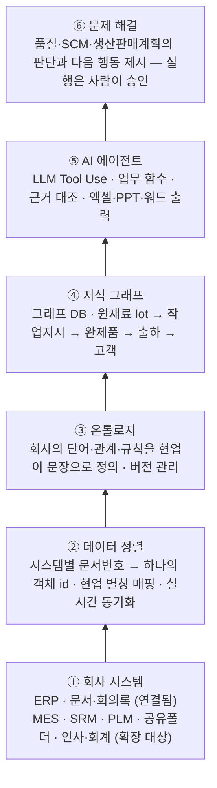
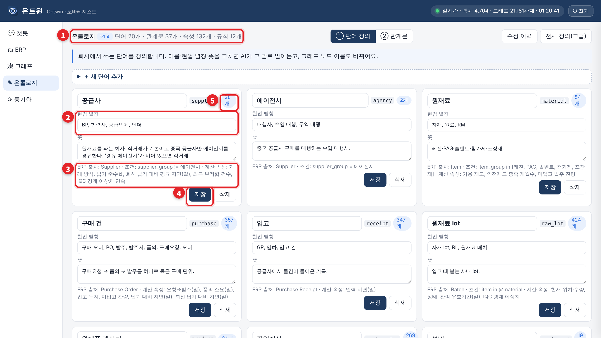
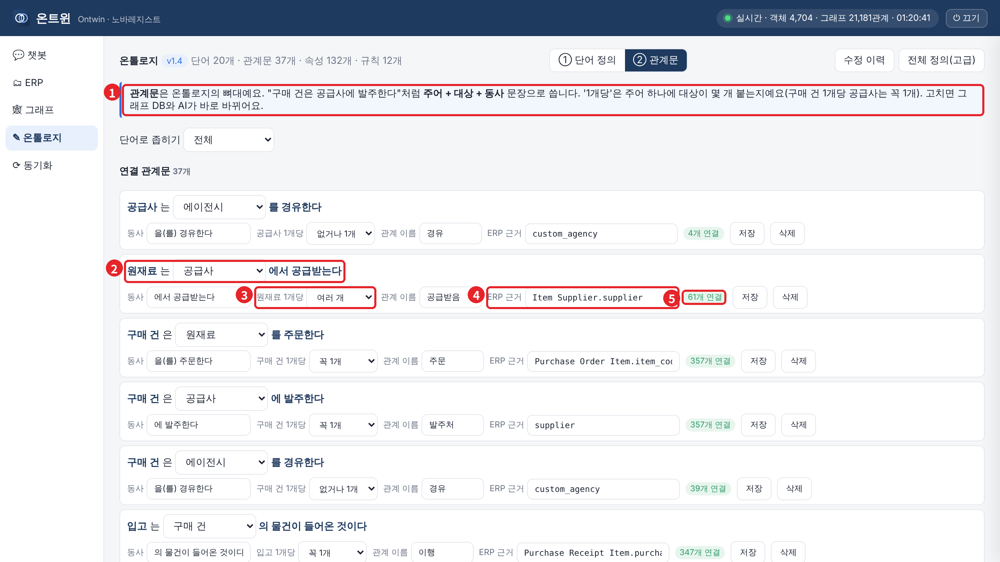
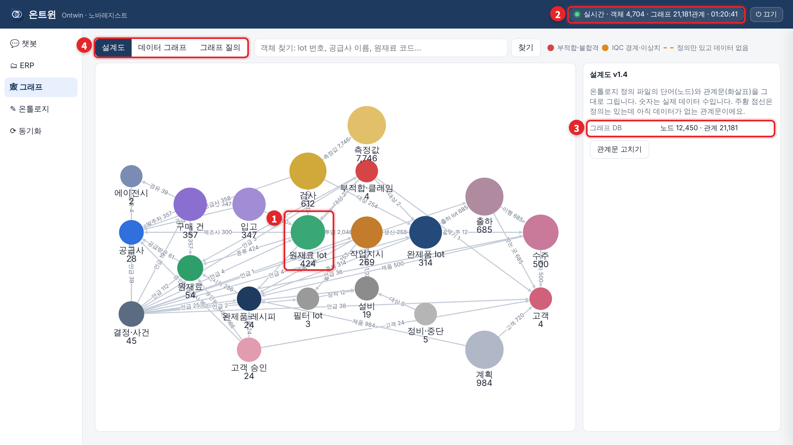
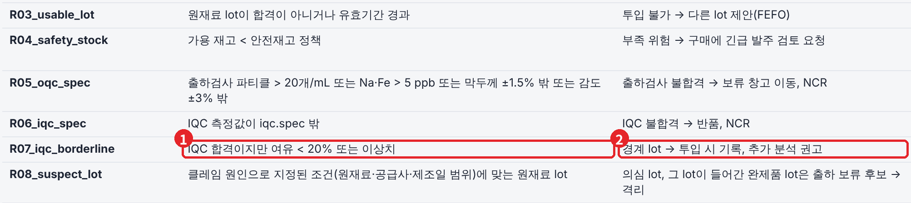
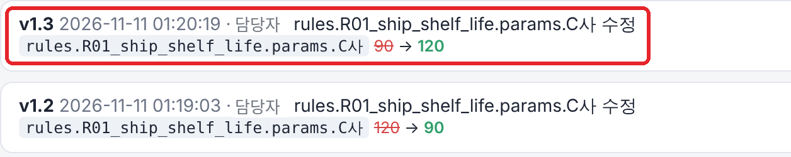
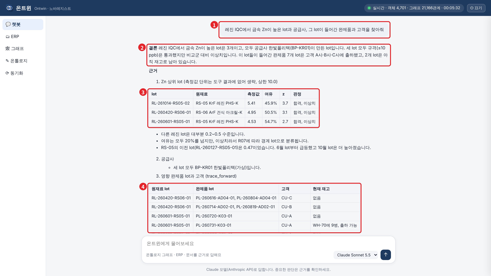
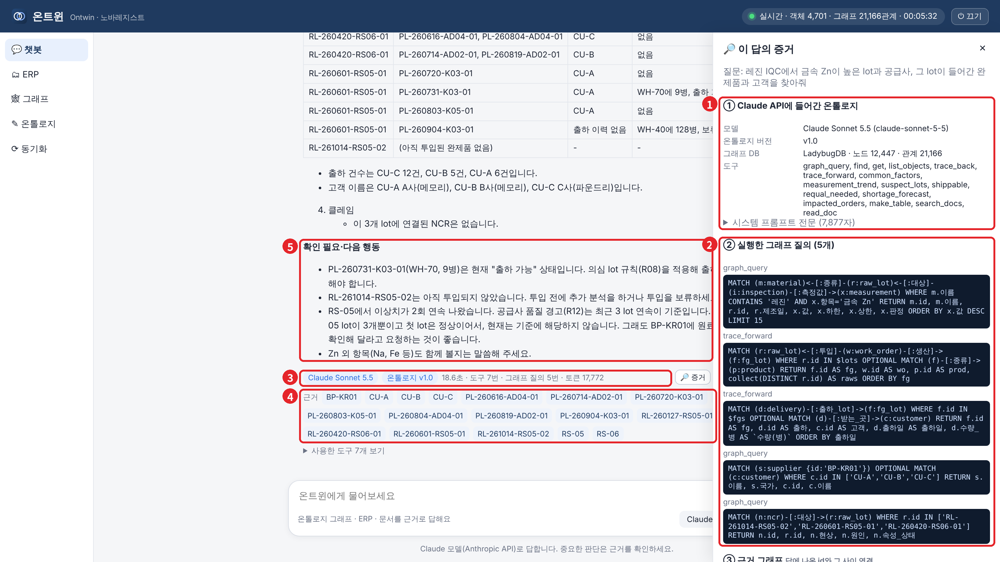

# Ontwin (온트윈)

**회사를 연결하고, 이해하여, 핵심 난제를 해결하는 온톨로지 기반 AI 파트너**

ERP와 사내 문서를 온톨로지로 연결하고, 그 위에서 AI가 **회사의 용어와 실제 데이터를 근거로** 품질·SCM·생산 판단을 돕습니다.
가상 반도체 PR 소재사 **노바레지스트(NovaResist)** 에 적용해 구현·검증했습니다.

> 회사·공급사·고객·수치는 모두 **가상**이며 실제 기업 데이터와 무관합니다.

---

## 왜 만들었나

반도체 소재 현장에서 개별 업무를 도구로 개선해도, 전사적 난제는 남았습니다.

1. **보안 때문에, AI는 회사를 몰랐습니다.** 폐쇄망이라 외부 AI를 쓸 수 없고, 사내 AI는 회사 용어·품번·lot을 몰라 엉뚱한 답을 냈습니다.
2. **고질적인 품질 문제는 AI로도 풀리지 않았습니다.** 원인 원재료와 그 이유를 찾으려면 품질·개발·생산·SCM 정보를 함께 봐야 하지만, 흩어진 데이터는 AI도 연결하지 못했습니다.
3. **팔란티어에서 답을 봤지만, 쓸 수는 없었습니다.** 온톨로지는 답이었지만 고비용 라이선스와 상주 구축은 중견·중소 소재사에 문턱이 높았습니다.

그래서 **회사별 맞춤 온톨로지 · 낮은 도입 비용 · 전사 단위 AI**를 목표로 직접 만들었습니다.

## 결과 한눈에

같은 모델(Claude Sonnet 5.5)에게 핵심 업무 질문 10개를 물었습니다. 일반 AI는 ERP 데이터만, Ontwin은 온톨로지로 연결된 회사 전체를 봅니다.

| | Ontwin | 일반 AI |
| --- | --- | --- |
| 예외 판단 (Q1–Q3) | **30 / 30** | 8 / 30 |
| 과거 결정·원인 추적 (Q4–Q7) | **33.5 / 34** | 20.5 / 34 |
| ERP 데이터 분석 (Q8–Q10) | **17.5 / 19** | 17 / 19 |
| **합계** | **81 / 83 (98%)** | 45.5 / 83 (55%) |
| 답변 시간 중앙값 | **33.5초** | 142초 |

ERP만으로 풀리는 질문은 비슷하고, **이유와 결정을 묻는 질문**에서 갈립니다. 문항별 결과·대표 장면·공개하는 한계는 [검증 문서](docs/evaluation.md)에 있습니다.

## 어떻게 동작하나 — 6개 층



### 온톨로지를 문장으로 만듭니다

현업이 회사의 언어를 직접 정의합니다. 문장 하나가 그래프의 연결 하나가 되고, ERP 필드와 1:1로 대조해 검증합니다.

| ① 단어 정의 — 현업 별칭·뜻·ERP 출처 | ② 관계문 — "원재료는 공급사에서 공급받는다" |
| --- | --- |
|  |  |

### 정의한 문장이 그래프와 규칙으로 바로 동작합니다

- **그래프**: 단어·관계문이 그대로 그래프 DB 스키마가 됩니다. 노드 숫자는 ERP 실제 건수이며, ERP 변경은 20초 안에 반영됩니다.
- **규칙**: 판단 기준도 문장으로 씁니다. 예) R07 "IQC 합격이지만 여유 20% 미만 또는 이상치 → 경계 lot, 투입 시 기록·추가 분석 권고"
- **버전**: 모든 수정은 시각·담당자·변경 전후 값과 함께 기록되고, 이전 버전으로 바로 되돌릴 수 있습니다.



| 규칙문 | 수정 이력 |
| --- | --- |
|  |  |

### 핵심 장면 — 품질 이슈 하나의 원인과 영향을, 근거와 함께

> "레진 IQC에서 금속 Zn이 높은 lot과 공급사, 그 lot이 들어간 완제품과 고객을 찾아줘"

Ontwin은 현업 용어 그대로 질문을 이해하고, 이상치 lot → 공급사 → 영향 완제품 → 고객까지 추적한 뒤, 실행한 그래프 질의와 근거 객체를 함께 보여줍니다.

| 답변 | 근거 (사용한 모델·온톨로지 버전·그래프 질의) |
| --- | --- |
|  |  |

## 세 가지 강점

| | |
| --- | --- |
| **GROUNDED** 원본 데이터·현업 용어 그대로 | ERP 문서번호 = 객체 id, 현업 별칭 매핑. 별도 가공·요약 없이 원본을 직접 조회합니다. |
| **VERIFIED** 할루시네이션 최소화 | 답의 모든 id를 도구 결과와 대조하고, 실행한 그래프 질의를 원문까지 공개합니다. |
| **LIGHTWEIGHT** 폐쇄망 소형 서버에서도 | 추론은 온톨로지·그래프 질의가 수행하고, LLM은 해석만 맡도록 설계했습니다. 경량 모델로의 동작은 다음 검증 과제입니다. |

## 데모 회사: 노바레지스트 (가상)

- 반도체 감광제(PR) 제조사, 연 매출 약 500억 규모로 설계
- 원재료 54종(레진·PAG·솔벤트·첨가제·포장재), 공급사 28곳(중국 2곳은 에이전시 경유), 고객 4곳, 완제품 24종
- 2026년 1년치 거래를 ERPNext v16에 적재: 수주 500 · 구매 357 · 원재료 lot 424 · 출하 685 · 측정값 7,746
- 실제 현장처럼 데이터 결함(누락·늦은 입력·단위 혼용·이름 불일치)과 숨은 품질 문제를 포함
- 결정 기록·메일·회의록·SOP 등 사내 문서([erp_seed/data/docs](erp_seed/data/docs))

## 규모

| 항목 | 값 |
| --- | --- |
| 온톨로지 | v1.4 · 단어 20 · 관계문 37 · 규칙 12 · 함수 11 |
| 그래프 DB (LadybugDB, Cypher) | 노드 약 12,450 · 관계 약 21,180 |
| 재구성 시간 | 정의 수정 → 그래프 재구성 약 3초 → 다음 답부터 반영 |
| ERP 실시간 반영 | 문서 변경 후 20초 이내 |

## 저장소 구성

| 폴더 | 내용 |
| --- | --- |
| `app/` | 프로그램 코드 — ERP 연결, 온톨로지 엔진·그래프 DB, 업무 함수, AI 에이전트, 웹 화면 |
| `ontology/` | 온톨로지 정의 `ontology.yaml` (문장형 명세는 `docs/ontology_spec.md`) |
| `erp_seed/` | 가상 회사 데이터와 ERPNext 적재 스크립트 |
| `docs/` | 요구사항·구조·설계 명세, [검증 결과](docs/evaluation.md), [그래프 DB 증거](docs/evidence.md) |
| `scripts/` | 실행·바탕화면 바로가기 스크립트 |

## 실행 방법 (Windows + WSL Ubuntu)

ERPNext가 Docker로 켜져 있어야 합니다(`http://localhost:8080`).

```bash
git clone https://github.com/HannesLee/novaresist-ontology-based-ai-system.git
cd novaresist-ontology-based-ai-system
pip install -r requirements.txt          # 처음 한 번
cp .env.example .env                     # ERP 주소·API 키, Anthropic API 키 입력
python3 -m app check                     # ERP 접속 + 정의 파일 검증
python3 -m app sync                      # ERP 전체 읽기 → 온톨로지
python3 -m app serve                     # http://localhost:8501/ow/
```

| 주소 | 화면 |
| --- | --- |
| `localhost:8501/ow/` | Ontwin: 챗봇, ERP 화면 분할, 그래프, 온톨로지 편집, 동기화 |
| `localhost:8501/app` | ERPNext 화면 + 오른쪽 아래 Ontwin 챗봇(지금 보는 문서를 알고 답함) |

- 평가처럼 기준일을 고정하려면 `ONTWIN_AS_OF=2026-10-30 python3 -m app serve`
- 바탕화면 바로가기: `powershell.exe -ExecutionPolicy Bypass -File "$(wslpath -w scripts/install_windows.ps1)"`

## 진행 상황

- [x] 가상 회사 설계·1년치 데이터 생성, ERPNext 구축·적재·검증
- [x] 온톨로지 정의(단어·관계문·규칙) + ERP 필드 1:1 대조
- [x] ERP 실시간 연동 + 실제 그래프 DB(LadybugDB, Cypher)
- [x] 업무 함수(추적·판정), AI 에이전트, 근거 공개 화면
- [x] 문장형 온톨로지 편집(버전 이력·되돌리기), 그래프 보기
- [x] ERP 화면 위 챗봇, 엑셀·PPT·워드 내보내기
- [x] 일반 AI vs Ontwin 비교 검증(10문항) → [결과](docs/evaluation.md)
- [ ] MES·SRM·PLM·공유폴더·인사·회계 연결
- [ ] 실제 현장 데이터·폐쇄망 환경 파일럿, 경량 모델 동작 검증

## 다음 단계

회사의 소프트웨어를 연결하고 온톨로지 위에서 전사 난제를 푸는 **End-to-End AI**가 목표입니다.

- **품질**: 클레임 → 원인 원재료 lot·공급사 추적, 의심 lot 출하 보류·4M 변경 재승인 판단, IQC 경계 lot 투입 전 경고
- **SCM**: 지진·봉쇄 시 생산기지 기준 영향 원재료 파악, 고객 FCST 변경 → 원재료 공급 일정 영향 즉시 파악, 단일 공급원 원재료의 매출 노출도 산출
- **생산·판매계획**: 자재 부족 → 작업지시 지연 → 납기 위험 사전 경고, 고객별 유효기간 기준 출하 배분, 과거 결정과 실제 결과 비교

## 만든 사람

반도체 소재사 개발구매 실무자. 온톨로지 설계와 평가 설계는 직접 하고, 코드는 Claude Code와 함께 작성했습니다.
