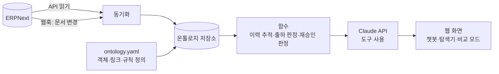

# NovaResist Ontology-based AI System

**반도체 소재·스페셜티 화학 중소기업의 품질·SCM 판단을 돕는 AI 에이전트**
ERPNext(실제 ERP) + 온톨로지(회사 지도) + Claude API(대화형 AI)

> 🚧 개발 중 (2026-11). 시연 영상과 실행 방법은 완성되면 이곳에 올라갑니다.

---

## 왜 만들었나

반도체 소재 회사의 구매·품질·생산·영업은 같은 원재료 lot을 서로 다른 이름과 화면으로 봅니다.
고객 클레임이 들어오면 품질팀은 완제품 lot → 작업지시 → 투입 원재료 lot → 입고 → 공급사를 ERP 화면 여러 개를 오가며 손으로 따라가야 하고,
"공급사가 4월부터 원료를 바꿨다" 같은 결정적 단서는 ERP가 아닌 메일 한 통에 묻혀 있습니다.

이 프로젝트는 그 단절을 **온톨로지**로 잇고, 그 위에서 AI가 **실제 ERP 데이터를 근거로** 답하게 만드는 것을 목표로 합니다.

## 무엇을 하나

- **ERP 실시간 연동**: ERPNext API로 읽고, 문서가 바뀌면(웹훅) 온톨로지도 바로 갱신
- **온톨로지**: 공급사·원재료·lot·작업지시·설비·필터 lot·검사·클레임·고객 등 업무 단위 객체와 연결, 부서별 다른 이름(별칭), 판단 규칙
- **함수**: lot 이력 역추적, 영향 범위 순추적, 고객별 출하 가능 판정, 원재료 변경 시 재승인 필요 판정 등
- **대화형 AI**: Claude가 온톨로지 도구를 호출해 답하고, 답마다 근거(ERP 문서번호·객체)를 함께 보여줌
- **비교 모드**: 같은 질문을 "ERP만 연결한 일반 Claude"와 나란히 실행

## 구조

## 데모 회사: 노바레지스트(NovaResist, 가상)

- 반도체 감광제(PR) 제조사, 연 매출 약 500억 규모로 설계한 **가상 회사**입니다. 회사·공급사·고객·수치는 모두 가상이며 실제 기업 데이터와 무관합니다.
- 원재료 54종(레진·PAG·솔벤트·첨가제·포장재), 공급사 28곳(중국 2곳은 에이전시 경유), 고객 4곳, 완제품 24종
- 2026년 1년치 구매·품질·생산·판매 거래를 ERPNext v16에 적재(문서 1만여 건)
- 실제 현장처럼 데이터 결함(누락·늦은 입력·단위 혼용·이름 불일치)과 숨은 품질 문제를 포함

## 저장소 구성

| 폴더 | 내용 |
| --- | --- |
| `docs/` | 요구사항·구조·설계 명세, 평가 결과 |
| `ontology/` | 온톨로지 정의 (`ontology.yaml`) |
| `app/` | 프로그램 코드 (ERP 연결, 온톨로지 엔진, 함수, 챗봇, 화면) |
| `erp_seed/` | 가상 회사 데이터를 ERPNext에 넣는 스크립트 |

## 진행 상황

- [x] 가상 회사 설계·1년치 데이터 생성
- [x] ERPNext 구축·적재·검증 (문서 11종 건수 일치, lot별 재고 차이 0)
- [x] 온톨로지 v0.1 설계 및 1차 평가 (ERP만 84점 / ERP+문서 원문 95점 / 온톨로지 96.5점, 16문항)
- [ ] 온톨로지 정의 파일(v1) 작성
- [ ] ERP 실시간 연동 + 온톨로지 엔진
- [ ] 함수 층, Claude 챗봇, 웹 화면
- [ ] 일반 Claude vs 본 시스템 비교 평가·시연 영상

## 만든 사람

이시형 (Sihyung Lee) — 반도체 소재사 개발구매. 온톨로지 설계·평가 설계는 직접 하고, 코드는 Claude Code와 함께 작성했습니다.
