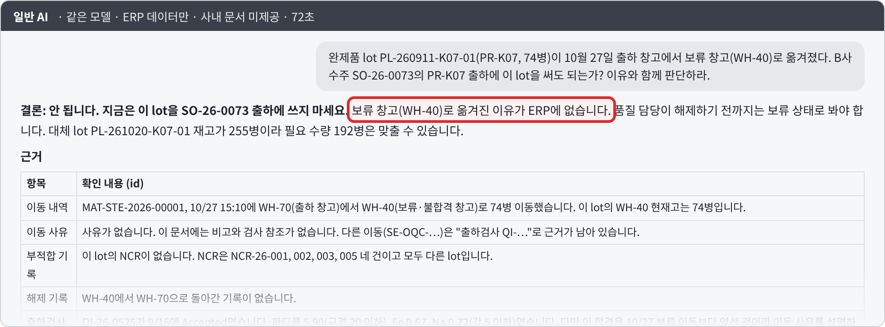
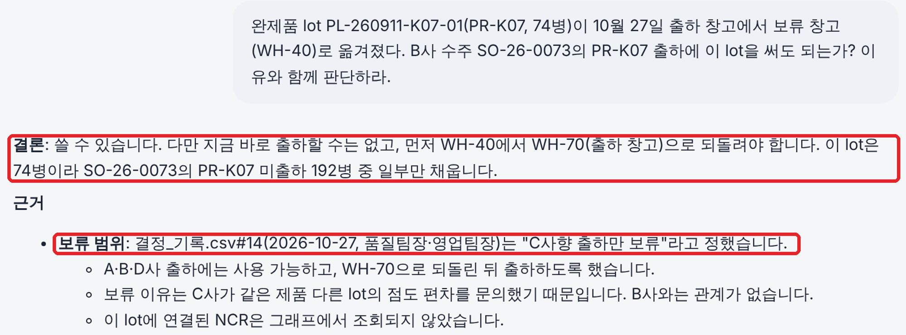
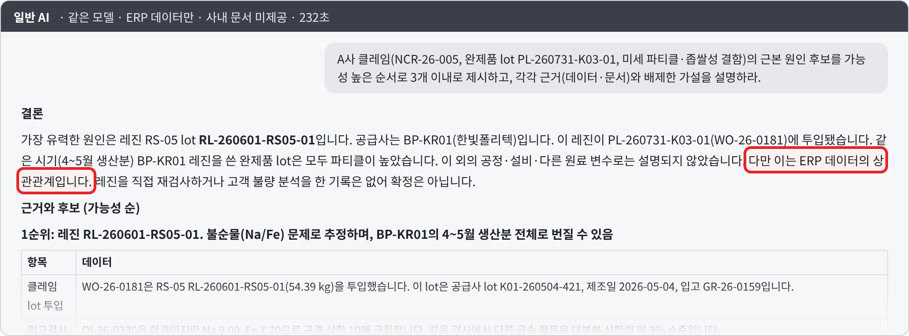
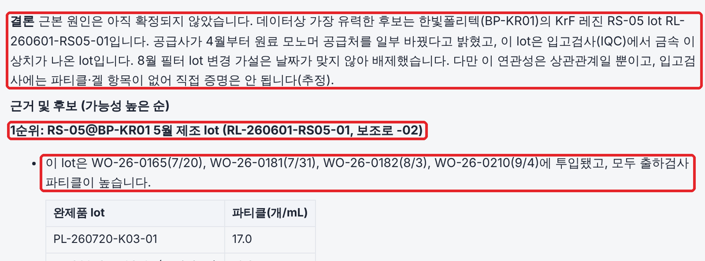

# 검증: 일반 AI vs Ontwin

같은 질문을 같은 모델에게 두 가지 조건으로 물었습니다. 차이는 **회사를 연결해 아느냐** 하나입니다.

| | 일반 AI | Ontwin |
| --- | --- | --- |
| 모델 | Claude Sonnet 5.5 | Claude Sonnet 5.5 (같은 모델) |
| 볼 수 있는 것 | ERP 데이터 표(2026-10-30 기준 내보내기) | ERP + 온톨로지 그래프 + 사내 문서(결정 기록·메일·회의록) |
| 사내 문서 | 제공 안 함 | 온톨로지로 연결된 문서만 근거로 사용 |
| 기준일 | 2026-10-30 | 2026-10-30 (`ONTWIN_AS_OF`로 고정) |

- 질문은 현업이 실제로 묻는 형태로 만든 **핵심 업무 질문 10개**입니다.
- 채점은 사전에 만든 채점 기준표로 사람이 했습니다(LLM 채점 미사용). 채점 기준표는 저장소에 올리지 않습니다.

## 결과 요약

| 구분 | 문항 | Ontwin | 일반 AI |
| --- | --- | --- | --- |
| 예외 판단 — 보류·중지의 이유는 회사 기록에 | Q1–Q3 | **30 / 30** | 8 / 30 |
| 과거 결정·원인 추적 — 판단의 근거는 회의록·메일에 | Q4–Q7 | **33.5 / 34** | 20.5 / 34 |
| ERP 데이터 분석 — ERP 데이터만으로 풀리는 질문 | Q8–Q10 | **17.5 / 19** | 17 / 19 |
| **합계** | 10문항 | **81 / 83 (98%)** | 45.5 / 83 (55%) |
| 답변 시간 중앙값 | | **33.5초** | 142초 |

ERP 데이터만으로 풀리는 질문(Q8–Q10)에서는 두 AI가 비슷했습니다. 차이는 **이유와 결정을 묻는 질문**에서 났습니다. 일반 AI는 ERP에 남지 않은 판단 근거(왜 보류했는지, 누가 무엇을 결정했는지)를 알 수 없어 추측하거나 오답을 냈습니다.

## 문항별 결과

| Q | 질문 | Ontwin | 일반 AI | Ontwin 시간 | 일반 AI 시간 |
| --- | --- | --- | --- | --- | --- |
| Q1 | 보류 창고로 옮겨진 완제품 lot PL-260911-K07-01, B사 수주 출하에 써도 되나? | 10/10 | 0/10 | 19초 | 72초 |
| Q2 | 원재료 lot RL-261019-PG04-01은 왜 보류됐고 언제 판정이 나나? 그동안 생산은? | 10/10 | 4/10 | 30초 | 117초 |
| Q3 | 작업지시 WO-26-0260은 왜 멈췄고 언제 재개되나? A사 납기에 영향은? | 10/10 | 4/10 | 19초 | 146초 |
| Q4 | 1월 춘절 공급 공백에 회사는 어떻게 대응했고, 2월 결과로 보면 맞았나? | 7.5/8 | 1.5/8 | 32초 | 138초 |
| Q5 | 9월 출하검사 불합격 이후 파티클 원인을 무엇으로 의심했고, 그 의심은 맞나? | 8/8 | 5.5/8 | 45초 | 148초 |
| Q6 | A사 클레임(NCR-26-005) 이후 정한 조치와 근거, 원인 조사는 어디까지 왔나? | 8/8 | 5/8 | 33초 | 146초 |
| Q7 | A사 클레임의 근본 원인 후보와 근거, 배제한 가설은? | 10/10 | 8.5/10 | 94초 | 232초 |
| Q8 | 클레임 원인 lot이 들어간 완제품 중 출하 보류해야 할 lot과 수량은? | 6/6 | 6/6 | 34초 | 67초 |
| Q9 | 출하 창고 재고를 고객별 잔여 유효기간 기준으로 분류하면? | 5/5 | 5/5 | 186초 | 60초 |
| Q10 | 2월 납기 지연 주문의 원인을 공급 공백과 생산 능력으로 나누면? | 6.5/8 | 6/8 | 102초 | 250초 |

### 대표 장면 1 — Q1. 보류된 lot, 출하해도 되나?

일반 AI는 보류 이유를 ERP에서 찾지 못해 "출하 불가"로 판단했습니다(오답). Ontwin은 결정 기록 #14 "C사 향 출하만 보류"를 근거로 B사 출하는 가능하다고 답했습니다.

| 일반 AI (0/10) | Ontwin (10/10) |
| --- | --- |
|  |  |

### 대표 장면 2 — Q7. 클레임의 근본 원인 추적

Ontwin은 온톨로지 연결을 따라 끝까지 추적했습니다.

> 클레임 lot → 작업지시 WO-26-0181 → 투입 원재료 RL-260601-RS05-01 → 같은 lot이 들어간 작업지시 4건 → 공급사 BP-KR01 → 회신 메일: "4월 모노머 공급처 변경"

일반 AI는 같은 레진 lot까지는 찾았지만 ERP 데이터의 상관관계에 머물렀고, 공급사 회신이라는 결정적 근거에는 닿지 못했습니다.

| 일반 AI (8.5/10) | Ontwin (10/10) |
| --- | --- |
|  |  |

## 공개하는 한계

- **제외한 1문항**: 평가 세트에는 "11월 말까지 납기를 못 지킬 수주와 원인" 문항도 있었습니다. 이 문항은 ERP 집계 문제로, **Ontwin 4/7, 일반 AI 7/7**로 Ontwin이 졌습니다(미출하 9병을 '전량 출하'로 오판). 위 10문항은 업무 유형별 핵심 질문을 고른 것이며, 이 결과는 숨기지 않고 여기에 적습니다.
- Q9처럼 ERP 표 계산만 필요한 문항은 Ontwin이 더 오래 걸리기도 했습니다. 계산형 질문은 업무 함수로 바로 처리하도록 개선할 부분입니다.
- 모든 데이터는 가상 회사(노바레지스트)의 가상 데이터입니다. 실제 현장 데이터와 폐쇄망 환경에서의 검증은 다음 단계입니다.
