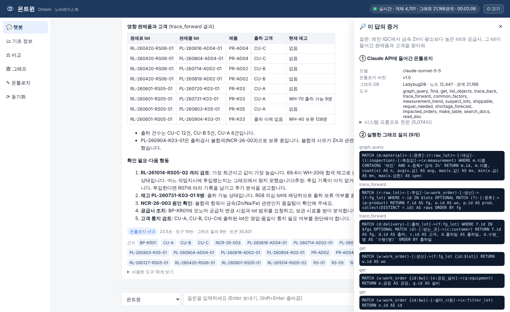
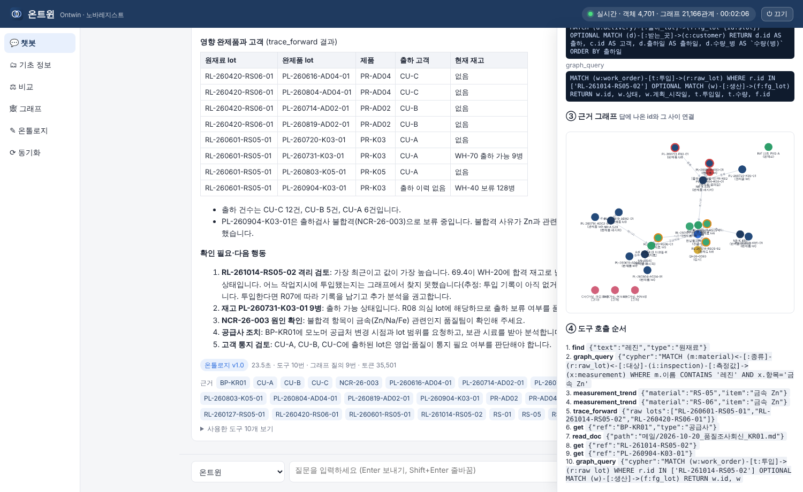
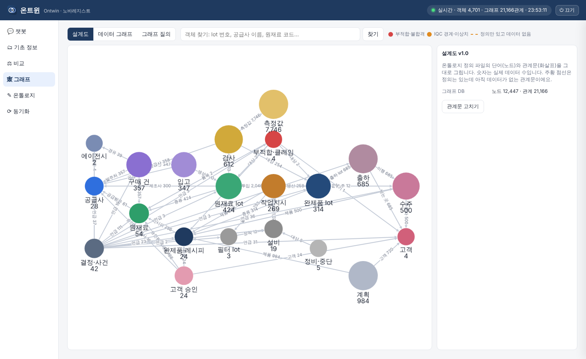
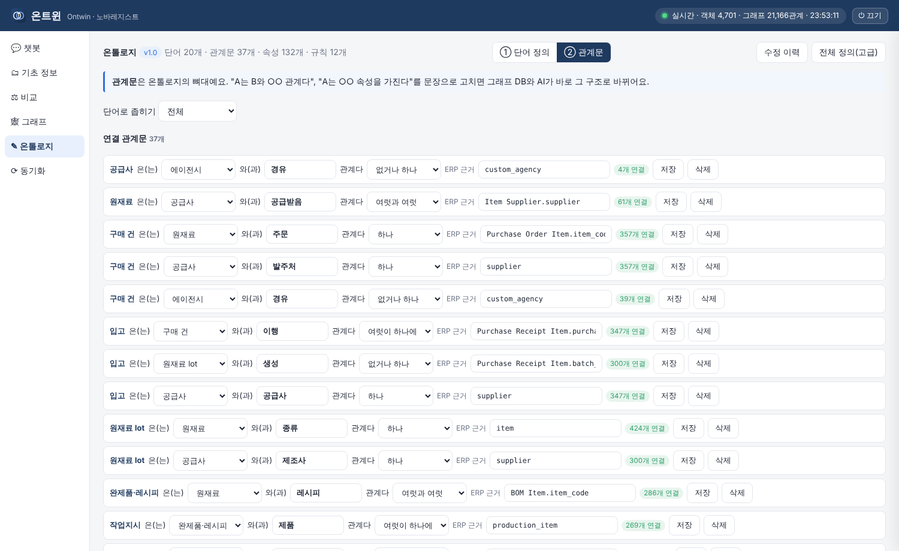
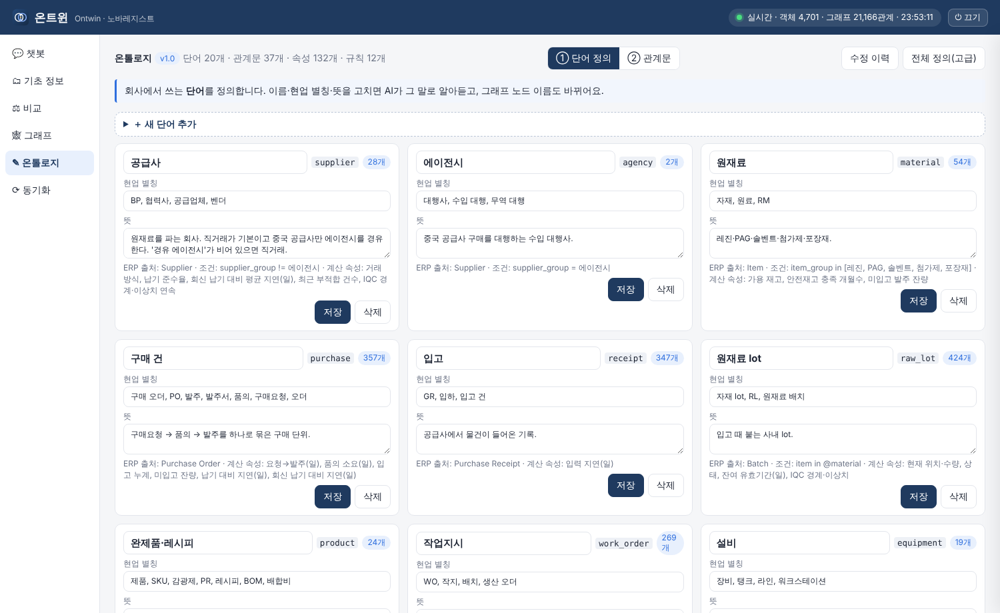
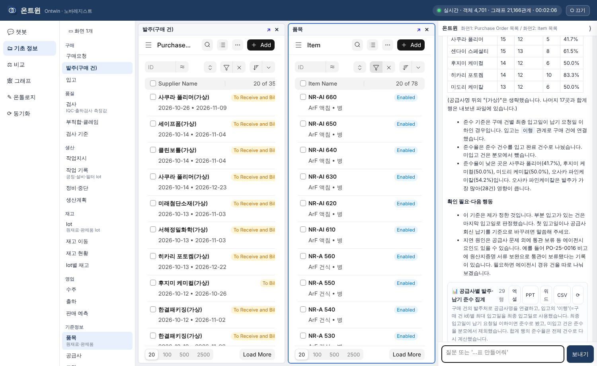

# 온트윈이 온톨로지를 실제로 쓴다는 증거

이 문서는 "온톨로지를 그래프 DB에 넣고, Claude API가 그 그래프를 조회해 답한다"는 것을 실행 기록으로 보여 줍니다. 모든 내용은 테스트 서버에서 실제로 돌린 결과입니다(2026-11-03).

## 1. 흐름

```
ontology/ontology.yaml (단어·관계문·규칙)
   │ ① 엔진이 정의대로 ERP를 읽음
   ▼
ERPNext ──API──▶ 객체 4,701개 · 연결 13,420개
   │ ② 정의에서 그래프 스키마를 만들어 적재 (3초)
   ▼
그래프 DB  LadybugDB(Kùzu 계열, Cypher)  노드 12,447 · 관계 21,166
   │ ③ 그래프 스키마·규칙을 시스템 프롬프트에 넣고, Cypher 도구(graph_query)와 함수를 줌
   ▼
Claude API (claude-sonnet-5-5) ──▶ 답 + 근거 번호 + 실행한 질의 기록
```

- ERP가 바뀌면 20초 안에 객체를 다시 만들고 그래프 DB를 새로 적재합니다.
- 화면에서 단어·관계문을 고치면 새 버전으로 저장되고, 그래프 DB 스키마와 Claude 프롬프트가 함께 바뀝니다(예: 원재료 lot에 '최초 수량' 속성을 추가하자 `r.최초_수량`으로 바로 Cypher 질의 가능).

## 2. Claude API에 들어가는 그래프 스키마 (시스템 프롬프트 일부, 실제 값)

```
노드 표 (라벨: 현업 이름 — 열)
- supplier: 공급사 — id, 이름, 상태, 국가, 공급_분류, 평가_등급, 표준_리드타임_일, 인코텀즈, 결제_조건
- agency: 에이전시 — id, 이름, 상태, 국가, 평균_통관_일수
- material: 원재료 — id, 이름, 상태, 분류, 세부_분류, 단위, 보관_조건, 유효기간_일, 구매_리드타임_일, 안전재고_정책_개월, 위험물, 밀도_g_mL, lot_관리, 생산_약칭, IQC_전_창고, 합격_창고, IQC_기준
- purchase: 구매 건 — id, 이름, 상태, 구매요청번호, 요청일, 요청_부서, 요청_사유, 품의번호, 품의_상신일, 품의_승인일, 승인자, 발주일, 수량, 단가, 금액, 공급사_품명, 납기_요청일, 공급사_회신_납기, 운송, 비고, ERP_상태
- receipt: 입고 — id, 이름, 상태, 입고일, ERP_입력일, 수량_입력_단위, 입력_단위, 수량_재고_단위, 입고_창고, COA_첨부, 공급사_lot, 수기_발주번호, 비고, 속성_상태
- raw_lot: 원재료 lot — id, 이름, 상태, 공급사_lot, 제조일, 유효기간, 설명, 최초_수량
- product: 완제품·레시피 — id, 이름, 상태, 제품군, 유효기간_일, 병당_단가, 고형분, 보관_조건
- work_order: 작업지시 — id, 이름, 상태, 배치량_L, 구분, 계획_시작일, 계획_종료일, 실제_시작일, 실제_종료일, 속성_상태, 계획_수량_병, 생산_수량_병, 수율, 배합_탱크
- equipment: 설비 — id, 이름, 상태, 종류, 용량, 정비_주기_일, 동시_작업_가능_수
- downtime: 정비·중단 — id, 이름, 상태, 시작, 종료, 중단_시간_시간, 중단_사유, 비고
- filter_lot: 필터 lot — id, 이름, 상태
- fg_lot: 완제품 lot — id, 이름, 상태, 생산일, 유효기간
- inspection: 검사 — id, 이름, 상태, 구분, 판정, 의뢰_일시, 시작_일시, 판정_일시, ERP_입력_일시, 검사자, 불합격_사유
- ncr: 부적합·클레임 — id, 이름, 상태, 구분, 발생일, 현상, 조치, 원인, 속성_상태, 종결일, 절차
- customer: 고객 — id, 이름, 상태, 업종, 원재료_변경_시_재승인_일, 출하_가능_잔여_유효기간_일, 매출_비중
- approval: 고객 승인 — id, 이름, 상태, 고객_품번, 승인일, 승인된_원재료_공급사
- sales_order: 수주 — id, 이름, 상태, 수주일, 고객_품번, 수량_병, 단가, 납기_요청일, 긴급, 비고, ERP_상태
- delivery: 출하 — id, 이름, 상태, 출하일, ERP_입력일, 수량_병, 출하_시_잔여_유효기간_일, 납기_준수
- plan: 계획 — id, 이름, 상태, 종류, 버전, S_OP_버전, 작성일, 대상월, 계획월, 속성_상태, 수량_병
- event: 결정·사건 — id, 이름, 상태, 날짜, 출처, 종류, 내용, 이유, 결정자, 결정, 관련_자료
- measurement: 검사 측정값 — id, 항목(예: '금속 Zn', '수분', '순도'), 값, 하한, 상한, 판정
관계 표 (이름: FROM→TO 쌍 [속성])
- 경유: purchase→agency, supplier→agency
- 고객: approval→customer, plan→customer
- 공급받음: material→supplier [공급사_품명]
- 공급사: inspection→supplier, receipt→supplier
- 공정_설비: work_order→equipment [공정]
- 대상: downtime→equipment, inspection→fg_lot, inspection→raw_lot, ncr→fg_lot, ncr→raw_lot
- 레시피: product→material [n1000L당_투입량]
- 받는_곳: delivery→customer
- 발주처: purchase→supplier
- 생산: work_order→fg_lot
- 생성: receipt→raw_lot
- 승인된_공급사: approval→supplier [조합]
- 승인된_원재료: approval→material [조합]
- 언급: event→agency, event→customer, event→delivery, event→equipment, event→fg_lot, event→filter_lot, event→material, event→ncr, event→product, event→purchase, event→raw_lot, event→sales_order, event→supplier
- 연결_수주: work_order→sales_order
- 이행: delivery→sales_order, receipt→purchase
- 장착: filter_lot→equipment
- 제기: ncr→customer
- 제조사: raw_lot→supplier
- 제품: approval→product, plan→product, sales_order→product, work_order→product
- 종류: fg_lot→product, raw_lot→material
- 주문: purchase→material
- 주문자: sales_order→customer
- 출하_lot: delivery→fg_lot
- 투입: work_order→raw_lot [수량, 투입일]
- 품목: ncr→material, ncr→product
- 필터_사용: work_order→filter_lot
- 측정값: inspection→measurement
```

시스템 프롬프트 전체 5,074자 · 도구 16개: graph_query, find, get, list_objects, trace_back, trace_forward, common_factors, measurement_trend, suspect_lots, shippable, requal_needed, shortage_forecast, impacted_orders, make_table, search_docs, read_doc

## 3. 실제 질문 하나의 실행 기록

**질문:** 레진 IQC에서 금속 Zn이 평소보다 높은 lot과 공급사, 그 lot이 들어간 완제품과 고객을 찾아줘

**결과:** 25.1초, 도구 11번, 그래프 질의 5번, 입력 토큰 39,816 (+캐시 49,070), 출력 3,403

도구 호출 순서:

1. `find` {"text": "레진", "type": "원재료"}
2. `graph_query` {"cypher": "MATCH (mat:material)<-[:종류]-(r:raw_lot)<-[:대상]-(i:inspection)-[:측정값]->(m:measurement) WHERE mat.이름 CONTAINS '레진' AND m.항목='금속 Zn' RETURN mat.id, mat
3. `measurement_trend` {"material": "RS-05", "item": "금속 Zn"}
4. `measurement_trend` {"material": "RS-06", "item": "금속 Zn"}
5. `trace_forward` {"raw_lots": ["RL-260601-RS05-01", "RL-261014-RS05-02", "RL-260420-RS06-01"]}
6. `get` {"ref": "BP-KR01"}
7. `read_doc` {"path": "메일/2026-10-20_품질조사회신_KR01.md"}
8. `get` {"ref": "RL-261014-RS05-02"}
9. `graph_query` {"cypher": "MATCH (w:work_order)-[t:投入]->(r:raw_lot) RETURN 1"}
10. `graph_query` {"cypher": "MATCH (w:work_order)-[t:투입]->(r:raw_lot {id:'RL-261014-RS05-02'}) OPTIONAL MATCH (w)-[:제품]->(p:product) OPTIONAL MATCH (w)-[:생산]->(f:fg_lot) RETURN 
11. `graph_query` {"cypher": "MATCH (c:customer) WHERE c.id IN ['CU-A','CU-B','CU-C'] RETURN c.id, c.이름"}

실행된 Cypher (Claude가 직접 쓴 것 + 함수 안에서 실행된 것):

- `graph_query`
```cypher
MATCH (mat:material)<-[:종류]-(r:raw_lot)<-[:대상]-(i:inspection)-[:측정값]->(m:measurement) WHERE mat.이름 CONTAINS '레진' AND m.항목='금속 Zn' RETURN mat.id, mat.이름, count(m) AS n, avg(m.값) AS avg, max(m.값) AS mx, min(m.값) AS mn ORDER BY mx DESC
```
- `trace_forward`
```cypher
MATCH (r:raw_lot)<-[:투입]-(w:work_order)-[:생산]->(f:fg_lot) WHERE r.id IN $lots OPTIONAL MATCH (f)-[:종류]->(p:product) RETURN f.id AS fg, w.id AS wo, p.id AS prod, collect(DISTINCT r.id) AS raws ORDER BY fg
```
- `trace_forward`
```cypher
MATCH (d:delivery)-[:출하_lot]->(f:fg_lot) WHERE f.id IN $fgs OPTIONAL MATCH (d)-[:받는_곳]->(c:customer) RETURN f.id AS fg, d.id AS 출하, c.id AS 고객, d.출하일 AS 출하일, d.수량_병 AS `수량(병)` ORDER BY 출하일
```
- `graph_query`
```cypher
MATCH (w:work_order)-[t:투입]->(r:raw_lot {id:'RL-261014-RS05-02'}) OPTIONAL MATCH (w)-[:제품]->(p:product) OPTIONAL MATCH (w)-[:생산]->(f:fg_lot) RETURN w.id, w.상태, w.속성_상태, p.id, f.id, t.수량, t.투입일
```
- `graph_query`
```cypher
MATCH (c:customer) WHERE c.id IN ['CU-A','CU-B','CU-C'] RETURN c.id, c.이름
```

답의 결론(요약): Zn 이상치 lot 3개(RL-260601-RS05-01 4.53, RL-261014-RS05-02 5.41, RL-260420-RS06-01 4.95 ppb, 레진 평균 약 0.5)는 모두 한빛폴리텍(BP-KR01) lot이고 IQC는 합격. 이 lot이 들어간 완제품 8개 lot과 출하 고객(A·B·C사), 남은 재고(WH-70 9병, WH-40 128병)를 그래프로 따라가 찾음. 공급사 회신 메일(4월부터 원료 공급처 다변화)도 '언급' 관계로 연결해 근거로 제시.

## 4. 화면 캡처

**답변 옆 '증거' — 들어간 온톨로지 버전·그래프 DB·도구, 실행된 Cypher**



**같은 답의 근거 그래프(답에 나온 id와 그 사이 관계)**



**설계도 — 정의 파일의 단어·관계문과 실제 데이터 수**



**관계문 편집 — 고치면 그래프 DB와 AI에 바로 반영**



**단어 정의 편집**



**기초 정보 — ERP 2화면 + 오른쪽 챗봇이 만든 표(엑셀·PPT 내보내기)**



## 5. 직접 확인하는 법

- 온트윈 → **그래프 → 그래프 질의**: 같은 그래프 DB에 Cypher를 직접 실행하고, 함수·Claude·사람이 실행한 질의 기록을 봅니다.
- 답변 아래 **🔎 증거**: 그 답에 들어간 시스템 프롬프트 전문, 실행된 질의, 근거 그래프.
- **비교** 탭: 같은 질문을 'ERP 조회만 가진 Claude'와 나란히 실행.

## 6. 솔직한 한계

- 그래프 DB는 매 동기화 때 통째로 다시 적재합니다(지금 규모 3초). 수십만 건 이상이면 변경분 적재로 바꿔야 합니다.
- 출하 판정·부족 예측 같은 규칙 계산은 파이썬 함수가 하고, 연결 탐색만 그래프 DB가 합니다.
- 객체 원본(속성 전체)은 SQLite에도 두고 화면 표시에 씁니다. 판단의 근거 경로는 그래프 DB 질의로 남습니다.
